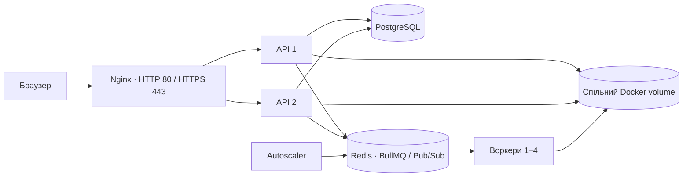

# Cloud Media Converter & Archiver

Вебзастосунок для асинхронної обробки зображень, архівування файлів і CPU-бенчмарку. Користувачі можуть стежити за прогресом задач у реальному часі, скасовувати їх і завантажувати готові результати. API працює у двох екземплярах за балансувальником Nginx; Redis керує чергою BullMQ, а PostgreSQL зберігає облікові записи та історію задач.

Проєкт створено відповідно до [технічного завдання](docs/TASK.txt). Деталі компонентів наведено в [описі архітектури](docs/ARCHITECTURE.md).

## Можливості

- **Конвертація зображень:** WebP, AVIF, JPEG або PNG; можна задати ширину та якість.
- **Архівування:** ZIP або TAR.GZ зі ступенем стиснення 1–9. Для демонстрації можна створити тестовий файл розміром 10 МБ.
- **CPU-бенчмарк:** матричні обчислення зі складністю 1–10; результатом є JSON-звіт.
- **Задачі та прогрес:** обробка через BullMQ, передавання прогресу й етапу через SSE, приблизний час очікування, скасування та завантаження результату.
- **Обмеження:** розмір завантаження та кількість одночасних активних задач на користувача налаштовуються через змінні середовища. Для виконання задачі також задано тайм-аут.
- **Авторизація:** реєстрація та вхід з JWT. Роль ADMIN можна отримати кодом реєстрації або через список email-адрес.
- **Балансування:** Nginx розподіляє HTTP та HTTPS-запити між двома API-серверами.
- **Автомасштабування воркерів:** watcher змінює бажану кількість активних воркерів від 2 до 4 залежно від черги.
- **Адмін-панель:** сторінка `/admin` показує стан Redis, воркерів і черги.

## Архітектура



Docker Compose піднімає PostgreSQL, Redis, два API-сервери, чотири воркер-контейнери, autoscaler і Nginx. Два воркери обслуговують чергу постійно; слоти 3 і 4 вмикаються механізмом масштабування за потреби. ETA обчислюється за середнім часом останніх 20 успішних задач; поки таких задач немає, використовується оцінка 20 секунд.

## Швидкий запуск

### Потрібно

- Docker Desktop із підтримкою `docker compose`.

### 1. Налаштуйте середовище

У PowerShell створіть локальний файл конфігурації та відредагуйте його:

```powershell
Copy-Item .env.example .env
```

Задайте у `.env` власний довгий випадковий `JWT_SECRET`. За потреби також задайте `ADMIN_REGISTRATION_CODE` або `ADMIN_EMAILS` для адміністрування. Файл `.env` не додається до Git.

### 2. Запустіть сервіси

З кореневої теки проєкту виконайте:

```bash
docker compose up --build -d
```

Під час першого запуску Docker збере застосунок і створить контейнери. Відкрийте [http://localhost](http://localhost) або [https://localhost](https://localhost). HTTPS використовує самопідписаний сертифікат, згенерований під час побудови образу Nginx, тому браузер покаже попередження про сертифікат.

### 3. Перевірте сервіси

| URL | Призначення |
| --- | --- |
| [http://localhost/health](http://localhost/health) | Перевірка API та балансувальника; `X-Served-By` містить ім’я API-сервера, а `X-Handled-By` — адресу upstream. |
| [https://localhost/health](https://localhost/health) | Перевірка HTTPS через Nginx. |
| [http://localhost/api/status](http://localhost/api/status) | Стан API, PostgreSQL, Redis і поточні ліміти. |
| [http://localhost/admin](http://localhost/admin) | Адмін-панель; потрібен обліковий запис ADMIN. |

Щоб перевірити балансування, кілька разів відкрийте `/health` або натисніть **Check connection** на головній сторінці.

## Налаштування

Основні параметри з `.env.example`:

| Змінна | Типове значення | Призначення |
| --- | --- | --- |
| `JWT_SECRET` | `media_archiver_jwt_super_secret_key_2026` | Секрет для підпису токенів. Замініть його перед запуском поза локальним середовищем. |
| `JWT_EXPIRES_IN` | `7d` | Строк дії токена. |
| `MAX_FILE_SIZE_MB` | `50` | Максимальний розмір завантаження в мегабайтах. |
| `MAX_CONCURRENT_TASKS_PER_USER` | `6` | Максимальна кількість активних задач користувача. |
| `TASK_TIMEOUT_SECONDS` | `120` | Тайм-аут виконання однієї задачі. |
| `ADMIN_REGISTRATION_CODE` | порожньо | Код, потрібний під час реєстрації нового ADMIN через форму. Порожнє значення вимикає реєстрацію ADMIN за кодом. |
| `ADMIN_EMAILS` | порожньо | Email-адреси через кому, яким надається роль ADMIN під час входу. |
| `POSTGRES_PORT` | `5432` | Порт PostgreSQL, доступний на хості. |
| `REDIS_PORT` | `6379` | Порт Redis, доступний на хості. |

Параметри PostgreSQL у Compose за замовчуванням — `postgres` / `postgres` / `media_archiver`. Якщо змінюєте `POSTGRES_USER`, `POSTGRES_PASSWORD` або `POSTGRES_DB`, синхронно оновіть рядки підключення та healthcheck у `docker-compose.yml`.

Щоб призначити ADMIN вже створеному обліковому запису, додайте його адресу в `ADMIN_EMAILS` і перезапустіть API:

```bash
docker compose restart api1 api2
```

## API

Захищені маршрути приймають JWT у заголовку `Authorization: Bearer <token>`. Для SSE та завантаження файлів вебінтерфейс передає токен через параметр `?token=`.

| Метод | Маршрут | Доступ | Призначення |
| --- | --- | --- | --- |
| `GET` | `/health` | відкритий | Перевірка API-сервера. |
| `GET` | `/api/status` | відкритий | Перевірка PostgreSQL, Redis і лімітів. |
| `POST` | `/api/auth/register` | відкритий | Реєстрація USER або ADMIN за кодом. |
| `POST` | `/api/auth/login` | відкритий | Вхід і отримання JWT. |
| `GET` | `/api/auth/me` | JWT | Дані поточного користувача. |
| `POST` | `/api/tasks` | JWT | Створення задачі та додавання до черги. |
| `POST` | `/api/tasks/generate-demo` | JWT | Створення тестового файлу для архівування. |
| `GET` | `/api/tasks` | JWT | Історія користувача — до 50 останніх задач. |
| `GET` | `/api/tasks/:id` | JWT | Стан і прогрес задачі. |
| `GET` | `/api/tasks/:id/events` | JWT | Потік прогресу через Server-Sent Events. |
| `POST` | `/api/tasks/:id/cancel` | JWT | Скасування задачі власником або ADMIN. |
| `GET` | `/api/tasks/:id/download` | JWT | Завантаження результату завершеної задачі. |
| `GET` | `/api/admin/metrics` | ADMIN | Метрики черги, воркерів та Redis. |

## Корисні команди

| Дія | Команда |
| --- | --- |
| Переглянути стан контейнерів | `docker compose ps` |
| Переглянути логи всіх сервісів | `docker compose logs -f` |
| Переглянути логи API 1 | `docker compose logs -f api1` |
| Переглянути логи воркерів | `docker compose logs -f worker1 worker2 worker3 worker4` |
| Переглянути логи autoscaler | `docker compose logs -f autoscaler` |
| Перезапустити API після зміни конфігурації | `docker compose restart api1 api2` |
| Зупинити контейнери | `docker compose down` |

`docker compose down` зупиняє та видаляє контейнери, але залишає дані в Docker volumes. PostgreSQL, Redis і файли задач зберігаються у volumes `postgres_data`, `redis_data` та `storage_data`.

## Структура проєкту

```text
.
├── backend/
│   ├── prisma/             # Схема PostgreSQL і Prisma
│   ├── public/             # Зібраний вебінтерфейс та статичні зображення
│   ├── src/
│   │   ├── processors/     # Обробка зображень, архіви, CPU-бенчмарк
│   │   ├── queue/          # BullMQ, Redis та масштабування воркерів
│   │   ├── routes/         # HTTP API
│   │   ├── services/       # Авторизація та метрики черги
│   │   ├── ui/             # React-інтерфейс
│   │   ├── watcher.ts      # Autoscaler
│   │   └── worker.ts       # Воркер задач
│   ├── Dockerfile
│   └── package.json
├── docs/                   # Технічне завдання й архітектура
├── nginx/                  # Reverse proxy, балансування та HTTPS
├── tasks/                  # План і список робіт
├── docker-compose.yml
├── .env.example
└── README.md
```
